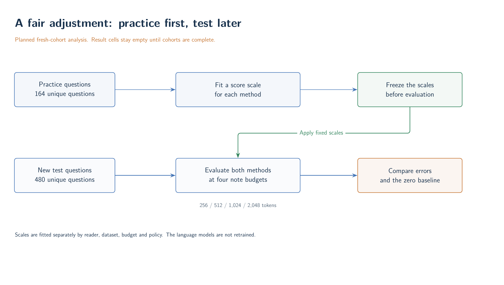

# Source Influence After Context Compression

**Frozen Deletion and Recomputed Evidence Selection**

Research report · 25 November 2026

Figures are rendered from TikZ and PGFPlots LaTeX sources. Pending experimental results remain unfilled.

## 1. Overview

An AI system can answer a question using a short selection of notes instead of the full set of source passages. When a source is removed, the notes can remain fixed apart from that source's content, or they can be selected again from the surviving passages. These operations can produce different estimates of how much the source affected the answer.

This study compares the two deletion protocols against a full-context reference. The answer tokens are held fixed, and influence is measured by their change in mean log probability. The completed main study covers four language models, three question collections and two evidence selectors. At a 512-token memory budget, frozen deletion reduces attribution error by 20.8–26.8% for BM25 and 10.6–13.3% for extractive RECOMP after averaging over the four readers. All six primary paired intervals favor frozen deletion.

These are improvements in agreement with a defined influence reference. They do not establish better answer accuracy, unique causal credit or uniformly accurate attribution. Some settings remain worse than predicting zero source effects. A separate study of development-only effect rescaling and four memory budgets is running; its incomplete cohorts are not used to draw conclusions here.

## 2. Introduction

Context compression shortens the information supplied to a language model. In an extractive system, a selector chooses sentences from a larger collection of passages and packs them into a limited memory. This changes both the evidence available for answering and the information available for auditing the answer.

A source-deletion audit measures how a fixed answer's score changes when one source is removed. In the full-context setting, the operation removes that source from the supplied passages. A compressed pipeline introduces another choice: remove its selected chunks from the existing memory, or run selection and packing again. Repeated selection may introduce new chunks, displace surviving chunks or change their positions.

For example, original notes may contain sources A and B. Removing A without replacement leaves B. Repacking may instead leave B and add information from C. Both operations remove A, but they change different model inputs. The question is whether either operation more closely reproduces deletion effects in the full context.

The full-context effect is a declared reference rather than ground-truth reasoning. A source can support an answer without receiving a large deletion effect, particularly when other passages or the model's stored knowledge supply the same information. Source influence and answer correctness are therefore evaluated separately.

## 3. Related Work

ContextCite studies the contribution of supplied context to generated responses [1](https://arxiv.org/abs/2409.00729). AttriBoT approximates leave-one-out influence using caching, hierarchical attribution and proxy models [2](https://arxiv.org/abs/2411.15102). These methods establish the attribution setting and important efficiency baselines. The present results do not establish an efficiency advantage over an optimized AttriBoT implementation.

RECOMP provides extractive and abstractive compressors for retrieval-augmented language models [3](https://arxiv.org/abs/2310.04408). This study uses its released extractive sentence scorer with a source-aware packing adapter. The Attribution–Compression Frontier evaluates citation support against compressed text and retrieved source spans [5](https://arxiv.org/abs/2609.14245). Citation support differs from the fixed-answer likelihood effects measured here.

Intervention choice is also an established concern. ICE shows that explanation evaluations depend on removal and replacement operators [4](https://arxiv.org/abs/2603.18579). Related tool-space work directly compares deleting recorded evidence with rerunning a tool chain [6](https://arxiv.org/abs/2609.34151). Local deletion versus re-execution is not a new distinction in general. The contribution here is a controlled comparison for budgeted evidence selection, with common answer targets and replication across fixed readers, benchmarks and selectors.

## 4. Method

### Reference measurement

For each question, the reader generates an answer from the full source context. Those answer tokens remain fixed throughout the attribution measurements, even when they do not match the dataset answer. A source effect is the difference in their mean token log probability before and after source removal. The full-context effect provides the reference.

Absolute differences between compressed and reference effects are averaged over source deletions within a question and then over questions. Lower mean absolute error (MAE) indicates closer agreement with the reference. Singleton deletions define the main metric; two predetermined source-pair deletions per question provide a secondary diagnostic.

### Deletion policies

Both compressed protocols begin with identical factual memory for a given selector. Frozen deletion removes the selected chunks owned by the deleted source. Recomputed deletion removes the source from the candidate pool and repeats the relevant selection and packing operations. Their original compressed score is therefore shared.

**Figure 1.** Source-removal measurements. Each row compares the same answer before and after the indicated operation. The two compressed protocols share their original memory and factual score.

BM25 has three evaluated policies: frozen deletion, repacking under the original candidate ranking, and repacking after refitting the ranking. The intermediate policy separates fixed-ranking refill from the additional ranking refit. Extractive RECOMP scores sentences independently; its recomputed policy repacks surviving candidates without a corpus-dependent ranking refit.

A source with no selected chunks has exactly zero frozen effect. This does not establish that its full-context influence is zero. A recomputation effect is not automatically spurious either: it may be appropriate for a system-removal question in which selection is intended to run again.

### Execution and uncertainty

The main study uses pinned model revisions, FP32 reader and encoder weights, forced math attention, disabled TF32 and explicit causal masks. Repeated factual scores and sampled re-executed raw-deletion endpoints are checked before results are interpreted. Main intervals bootstrap question identities after averaging paired error differences across the four fixed readers. Shared questions across readers are not independent observations.

## 5. Experiments and Results

### Completed main study

The completed matrix contains Qwen2.5-7B-Instruct, Llama-3.1-8B-Instruct, Mistral-7B-Instruct-v0.3 and Qwen2.5-14B-Instruct: four readers from three model families. Hotpot contributes 400 questions, MuSiQue 240 and 2Wiki 200. The matrix contains 840 distinct questions and 3,360 reader–question evaluations. Both selectors use a 512-token memory cap.

Hotpot is a reused replication cohort. MuSiQue and 2Wiki were selected before their corresponding main-study reader scores. Dataset and checkpoint revisions, cohort hashes and source ownership are recorded in the repository. Question-disjointness checks do not establish absence of document, pretraining or selector-training overlap.

| Dataset | Selector | Frozen | Recomputed | Reduction | 95% paired interval |
| --- | --- | --- | --- | --- | --- |
| Hotpot | BM25 | 0.4705 | 0.6346 | 25.9% | [-0.2308,-0.1116] |
| Hotpot | RECOMP | 0.5018 | 0.5785 | 13.3% | [-0.1074,-0.0499] |
| MuSiQue | BM25 | 0.2816 | 0.3847 | 26.8% | [-0.1450,-0.0694] |
| MuSiQue | RECOMP | 0.2791 | 0.3209 | 13.0% | [-0.0565,-0.0282] |
| 2Wiki | BM25 | 0.4307 | 0.5440 | 20.8% | [-0.1739,-0.0606] |
| 2Wiki | RECOMP | 0.4292 | 0.4799 | 10.6% | [-0.0954,-0.0137] |

**Table 1.** Four-reader average singleton MAE. The paired interval is for frozen-minus-recomputed MAE; negative values favor frozen deletion. Percent reductions use the ratio of averaged MAEs.

All six primary intervals have upper bounds below zero, satisfying the planned main-study criterion (Table 1). This establishes a result for the tested readers, selectors, budget and intervention contracts rather than a population of all models or compressors.

**Figure 2.** Attribution-error differences with 95% question-bootstrap intervals. Negative values favor frozen deletion. The zero line represents equal protocol errors, not the zero-effect prediction baseline.

| Reader | Hotpot | MuSiQue | 2Wiki |
| --- | --- | --- | --- |
| Qwen2.5-7B | 24.7% / 11.3% | 26.3% / 9.2% | 13.4% / 8.6%† |
| Llama3.1-8B | 21.2% / 7.9% | 17.0% / 8.6% | 11.1% / 8.9%† |
| Mistral7B | 24.4% / 17.2% | 33.7% / 20.0% | 21.2% / 15.1% |
| Qwen2.5-14B | 29.5% / 14.9% | 28.4% / 16.1% | 27.7% / 10.4%† |

**Table 2.** Per-reader error reductions: BM25 / RECOMP. A dagger marks a RECOMP interval that includes zero. Individual intervals are exploratory and unadjusted.

BM25 favors frozen deletion in all twelve individual reader–dataset comparisons. RECOMP favors it on Hotpot and MuSiQue for every reader. On 2Wiki, individual RECOMP intervals include zero for Qwen7, Llama8 and Qwen14. The averaged result therefore coexists with uncertainty in particular reader settings.

### Earlier experiments

Earlier experiments examined several possible ways to preserve source effects. Their cohorts, targets and numerical settings differ from the main matrix and are not pooled as independent confirmation.

| Experiment | Scope | Outcome |
| --- | --- | --- |
| Replay prototype | 120 mixed cases; 12 online checks | No established efficiency win over cheap source-ID tracing. |
| Source-local compression | Small development profiles | No demonstrated improvement over strong lexical selection. |
| Anchored paired training | Three matched-state seeds; 96 questions | No reliable special advantage over matched unpaired supervision. |
| FP32 budget frontier | Hotpot 96; MuSiQue 32 per reader | Larger budgets helped Hotpot, but not reliably MuSiQue. |
| Position/replacement | Two readers; 24 questions per benchmark | Numerical-equivalence gate failed; no validated pure mechanism conclusion. |
| Hotpot follow-up | Same 400 questions; two readers | Fixed-ranking refill and additional BM25 refitting both increased error; relative dominance remained uncertain. |

**Table 3.** Earlier exploratory and follow-up experiments. Full historical tables are retained in the numerical appendix.

### Fresh calibration and budget study

The new study tests whether the frozen advantage survives a fair adjustment of effect magnitude. A nonnegative scale is fitted separately for each reader, benchmark, budget and policy using development questions only. It minimizes question-average singleton L1 error against development raw effects. This is effect rescaling, not probability or temperature calibration; language-model weights are unchanged.

The cohorts contain 324 new MuSiQue questions (84 development, 240 test) and 320 new 2Wiki questions (80 development, 240 test). Qwen7 and Mistral7 are evaluated at 256, 512, 1024 and 2048 tokens. This gives 1,288 reader–question evaluations and 5,152 reader–question–budget configurations, not 5,152 independent questions.

**Figure 3.** Development-only rescaling and fresh evaluation. The diagram specifies the ongoing procedure, not a completed calibration result.

The validated snapshot of 25 November 2026, 17:14 EST, contains five completed full shards, all from Qwen MuSiQue. A sixth shard was running with eighteen additional saved questions. Planned time-limit requeues resumed checkpoints successfully. No complete fresh cohort was available for the planned analysis.

| Reader | Fresh cohort | Shards | Development | Test |
| --- | --- | --- | --- | --- |
| Qwen2.5-7B | MuSiQue | 5/8 | 54/84 | 150/240 |
| Qwen2.5-7B | 2Wiki | 0/8 | 0/80 | 0/240 |
| Mistral7B | MuSiQue | 0/8 | 0/84 | 0/240 |
| Mistral7B | 2Wiki | 0/8 | 0/80 | 0/240 |

**Table 4.** Completed-shard progress at the saved snapshot. Counts exclude the active partial shard. Both new model smokes passed.

| Fresh cohort | Tokens | BM25 rescaled difference | RECOMP rescaled difference | Frozen vs. zero |
| --- | --- | --- | --- | --- |
| MuSiQue | 256 |  |  |  |
| MuSiQue | 512 |  |  |  |
| MuSiQue | 1024 |  |  |  |
| MuSiQue | 2048 |  |  |  |
| 2Wiki | 256 |  |  |  |
| 2Wiki | 512 |  |  |  |
| 2Wiki | 1024 |  |  |  |
| 2Wiki | 2048 |  |  |  |

**Table 5.** Pending fresh-cohort results. Blank cells indicate unavailable analyses, not zero effects or negative findings. Test differences will average the two fixed readers within each question. The 512-token comparisons are primary; other budgets are secondary.

The primary rescaling criterion requires all four benchmark–selector frozen-minus-recomputed intervals at 512 tokens to favor frozen deletion. A separate criterion compares rescaled frozen effects with zero prediction. Matched-length donor controls vary newly admitted content while preserving branch length. Donors are not assumed neutral or irrelevant. These criteria remain unevaluated in the saved snapshot.

## 6. Findings and Limitations

The completed evidence supports a relative protocol effect. Freezing selected evidence improves average agreement with the specified full-context deletion reference. The factual-memory and fixed-answer controls support comparison across the tested model families and both selectors.

Absolute quality remains a limitation. Under pooled normalized error, frozen BM25 performs worse than predicting zero effects in six of twelve reader–dataset cells; frozen RECOMP does so in four. Zero prediction cannot meaningfully rank sources, but it is an important error sanity check. Pooled weighting differs from primary question-average MAE when source counts vary. A relative improvement alone is therefore insufficient to establish an accurate attribution method.

Lower effect MAE also does not consistently improve top-source recovery or deletion-answer agreement. Factual compressed QA is identical between deletion policies by construction because their original memory is identical. It is not an independently discovered answer-quality gain.

Earlier positional and donor ablations were inconclusive and included failed numerical-equivalence checks. The results do not isolate a pure replacement or positional mechanism. Full-context deletion remains a chosen reference, not a unique allocation of causal credit. Redundant evidence, stored model knowledge, incorrect factual answers and source exposure further limit interpretation.

## 7. Examples

Three Qwen7 cases illustrate relative improvement, individual failure and weak absolute accuracy. Cases were selected by declared median-contrast rules rather than maximum gains. They are illustrations, not estimates of population frequencies. The published records include trace hashes, fixed targets and complete singleton vectors.

**Example A.** The Hotpot question asks, “What was the capital of India when the Taj Mahal was commissioned?” The full-context answer, Agra, matches the dataset answer. Frozen deletion has error 0.124, compared with 0.214 for recomputed selection.

**Example B.** For “Are After Midnight Project and Aaroh both rock bands?”, the full-context model answers UNKNOWN while the dataset answer is yes. Recomputed selection is closer to the reference: 0.393 versus 0.435. An average improvement does not imply a gain on every question.

**Example C.** A MuSiQue question asks which mountain is visible from Portland in the state containing Raven Creek. The model answers Mount Hood; the dataset answer is Tualatin Mountains. Frozen deletion reduces error from 1.848 to 0.342, but zero prediction has still lower error, 0.227. A large relative reduction can coexist with a weak absolute estimate and a mismatch with the dataset answer.

| Example | Frozen MAE | Recomputed MAE | Zero MAE |
| --- | --- | --- | --- |
| A | 0.124 | 0.214 | 0.257 |
| B | 0.435 | 0.393 | 0.347 |
| C | 0.342 | 1.848 | 0.227 |

**Table 6.** Question-average singleton errors in the examples. Lower is closer to the full-context reference. Zero prediction assigns no influence to every source.

## 8. Conclusion and End Note

The completed study demonstrates that deletion policy materially affects attribution fidelity under context compression. Frozen deletion produces lower mean error than recomputed selection across all six fixed-reader-average comparisons at 512 tokens. The findings support explicit reporting of what is removed, what is retained and whether evidence selection runs again.

The result is narrower than a general claim of faithful reasoning or better answers. Absolute-error failures, mixed ranking and answer diagnostics, and uncertain mechanism controls remain part of the evidence. The ongoing fresh-cohort study evaluates whether the advantage persists after development-only effect rescaling and across budgets. Pending outcomes are not inferred from the completed unscaled study.

## References

1. B. Cohen-Wang, H. Shah, K. Georgiev and A. Madry. *ContextCite: Attributing Model Generation to Context*. 2024. [arXiv:2409.00729](https://arxiv.org/abs/2409.00729).

2. F. Liu, N. Kandpal and C. Raffel. *AttriBoT: A Bag of Tricks for Efficiently Approximating Leave-One-Out Context Attribution*. 2024/2025. [arXiv:2411.15102](https://arxiv.org/abs/2411.15102).

3. F. Xu, W. Shi and E. Choi. *RECOMP: Improving Retrieval-Augmented LMs with Compression and Selective Augmentation*. 2023. [arXiv:2310.04408](https://arxiv.org/abs/2310.04408).

4. A. Basu and P. Chakraborty. *ICE: Intervention-Consistent Explanation Evaluation with Statistical Grounding for LLMs*. 2026. [arXiv:2603.18579](https://arxiv.org/abs/2603.18579).

5. D. Mody. *The Attribution-Compression Frontier in Retrieval-Augmented Generation*. 2026. [arXiv:2609.14245](https://arxiv.org/abs/2609.14245).

6. X. Zhang et al. *Self-Evolving Agents via Likelihood-Guided Tool-Space Optimization*, Appendix E.3. 2026. [arXiv:2609.34151](https://arxiv.org/abs/2609.34151).

## Supplementary material

[LaTeX figure sources](figures/report/latex/report_figures.tex) · [Complete numerical appendix](research/PRESENTATION_TABLES.md) · [Example records and trace hashes](research/REPORT_EXAMPLES.json) · [Fresh-study protocol](research/v5/STABILITY_PROTOCOL.md)
