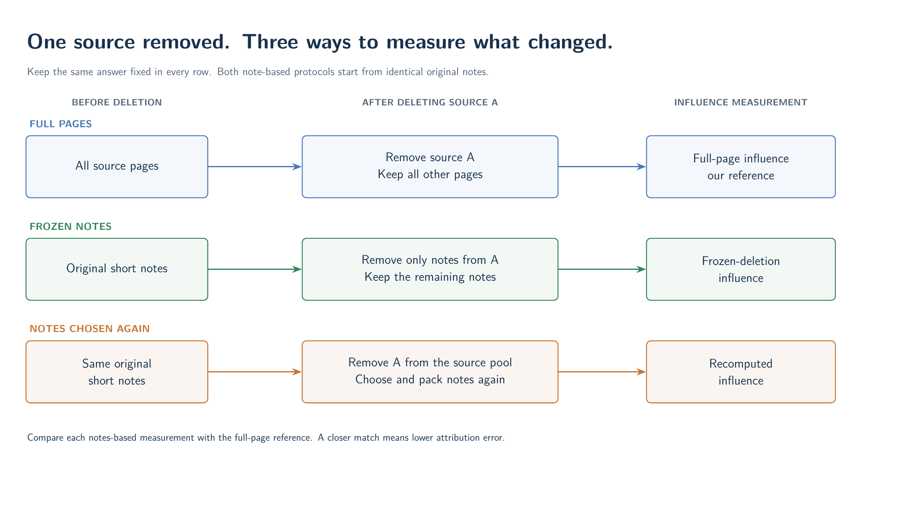
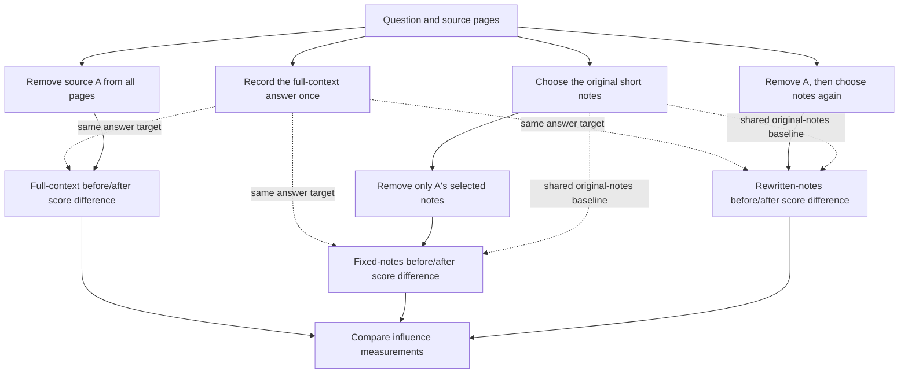
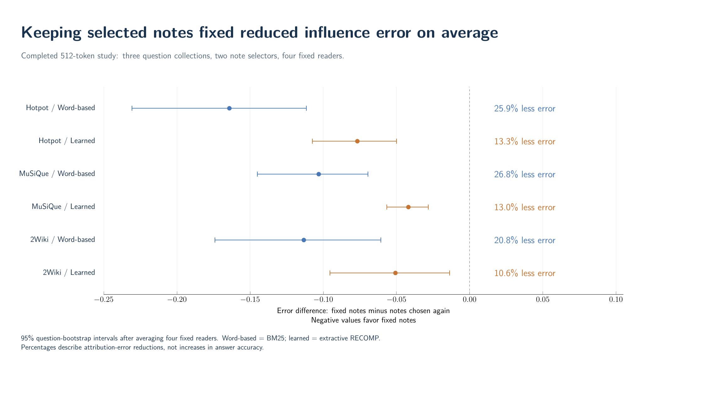

# Final report design: explain the idea before the machinery

**Working title:** Short Notes and the Sources Behind an AI Answer

**Subtitle:** How rewriting selected evidence changes our measurement of source influence.

Audience: readers who have not seen the project. Suggested format: eight main-report pages plus an appendix, or thirteen slides for a fifteen-minute talk. These are presentation choices, not a conference page-limit requirement. Use everyday language in the main story; put equations, runtime details, job IDs and all numerical tables in the appendix.

The report’s central sentence:

> We compared two ways of removing a source from short notes. Keeping the original selection fixed gave influence measurements closer to the full-context reference on average.

The completed generalization study supports this sentence. The new calibration and budget study is still running. Do not describe its results as complete.

## 1. Overview — the thirty-second version

**Opening script, ready to read aloud:**

> Imagine an open-book question. The book is long, so we give the AI a short set of notes. Now we want to know which source page mattered to its answer. We remove one source and repeat the measurement. But if we also rewrite the notes, other information may enter or disappear. Our project compares keeping the remaining notes fixed with choosing the notes again. We check both against the measurement made using all the source pages.

Show only three pictures at this point: **source pages → short notes → answer**. Explain that “context” means the information supplied with the question, and “compression” means shortening that information. Introduce the model and dataset names later.

**One completed-result sentence:** At the tested 512-token budget, keeping notes fixed reduced influence error by about 21–27% for word-based selection and 11–13% for learned sentence selection, averaged over four AI models across three question collections. These percentages concern influence-measurement error, not answer-accuracy improvement.

## 2. Introduction — make the problem visible

Start with a teaching illustration, clearly labeled **illustrative, not an experimental result**:

| Sources available | Original notes | Remove source A: fixed notes | Remove source A: rewrite notes |
|---|---|---|---|
| A: museum opening year; B: museum location; C: city festival | A + B | B | B + C |

The second operation removes A **and** introduces C into the notes. It can therefore produce a different influence measurement. This illustration shows the distinction; it does not prove that one operation will always be more accurate.

State the research question in plain language:

> Which editing rule gives a measurement closer to removing the same source from the full set of pages?

Explain why someone should care: a system can return an answer while giving a misleading impression of which supplied sources affected it. An answer matching the dataset, a supporting citation and a measured source effect are different things. Our experiment studies the last of these.

## 3. Related work — describe families of ideas, not a list of names

Use this small table. Say the middle column aloud; keep the paper names as references.

| Earlier work | Plain-language explanation | How our study is positioned |
|---|---|---|
| [ContextCite](https://arxiv.org/abs/2409.00729) | Studies how supplied context contributes to generated text. | Context attribution already exists; we examine its behavior under our compression/deletion protocols. |
| [AttriBoT](https://arxiv.org/abs/2411.15102) | Makes leave-one-out context influence estimates more efficient using caching, hierarchy and proxies. | We do not claim an efficiency win over it without a matched benchmark. |
| [RECOMP](https://arxiv.org/abs/2310.04408) | Makes shorter context using extractive or abstractive compressors. | We use a released extractive scorer with a source-aware packing adapter. |
| [ICE](https://arxiv.org/abs/2603.18579) | Shows that changing how information is removed or replaced can change explanation evaluations. | Generic intervention dependence is established; our result is a specific controlled comparison. |
| [Attribution–Compression Frontier](https://arxiv.org/abs/2609.14245) | Studies citation support against compressed text and source spans. | Citation support differs from our fixed-answer likelihood-effect target. |
| [Likelihood-guided tool-space optimization, Appendix E.3](https://arxiv.org/html/2609.34151#A5.SS3) | Compares deleting recorded evidence with rerunning a tool chain. | Local deletion versus re-execution has direct precedent; our budgeted evidence-selector setting is different. |

**Transition:** The contribution is the measured comparison across readers, question collections and selectors under a declared reference. Do not claim that removing evidence, caching computations or noticing intervention dependence was invented here. The [longer literature audit](research/v4/LITERATURE_EXPLORATION.md) supplies additional context.

## 4. Method — three routes, one fair comparison

Explain the procedure in five short steps:

1. Give the model the full set of source pages and record its answer once.
2. Keep those answer tokens fixed throughout the influence measurement, even if the answer is wrong.
3. Measure how the score for that same answer changes when a source is removed from the full context. This is our reference measurement.
4. Make short notes and repeat the measurement under two editing rules: keep the original selection fixed, or choose the notes again after removing the source.
5. Compare each notes-based source effect with the full-context effect. Average the absolute differences. Smaller error means closer agreement with the reference.

**Caption to say aloud:** Both note-based methods start with exactly the same original notes and use the same fixed answer. They differ in what happens after a source is removed.

Editable flow for the written report:

Introduce technical names only now: **frozen deletion** means fixed notes; **recomputed deletion** means selecting/packing notes again. The tested selectors choose existing sentences; “rewriting notes” here means changing the selection and packing, not paraphrasing the sentences. BM25 is the word-based selector. Extractive RECOMP is the learned sentence selector. A separate fixed-ranking refill branch measures what changes when the candidate order stays fixed but packing is repeated. RECOMP repacking does not refit a corpus-dependent ranker.

The full-context reference is an explicit comparison target, not a proof of unique knowledge origin or correct causal credit. Rerunning the full pipeline can be appropriate for a different system-removal question.

## 5. Experiments and results — one result at a time

### Setup panel

| Item | Completed main study |
|---|---|
| AI models | Qwen2.5-7B, Llama-3.1-8B, Mistral-7B-v0.3, Qwen2.5-14B: four readers from three families |
| Question collections | Hotpot 400; MuSiQue 240; 2Wiki 200 |
| Distinct questions / evaluations | 840 questions; 3,360 reader–question evaluations |
| Notes | At most 512 answerer-token positions; word-based and learned sentence selection |
| Comparison | Same factual notes and raw-answer targets; FP32, deterministic math attention |
| Scope | Hotpot is a reused replication cohort; MuSiQue and 2Wiki were frozen before the main reader scores |

Explain the collection names as three sets of questions. Do not assume that the audience knows them.

### Lead result table

| Question collection | Less influence error: word-based notes | Less influence error: learned notes |
|---|---:|---:|
| Hotpot | 25.9% | 13.3% |
| MuSiQue | 26.8% | 13.0% |
| 2Wiki | 20.8% | 10.6% |

Each percentage compares frozen with recomputed/repacked context, using the ratio of four-reader average MAEs. All six primary paired uncertainty intervals favor frozen deletion. The uncertainty analysis averages readers within each question before resampling questions; repeated readers are not independent questions.

For a technical audience, show the interval plot after explaining that it displays an **error difference**, so values left of zero favor frozen deletion:

Keep the twelve model–dataset MAE tables, normalized errors, QA and ranking metrics in the [full results appendix](research/PRESENTATION_TABLES.md). In the talk, show one compact per-reader slide rather than all 22 appendix tables.

### New study — reserve this space; do not fill it early

The new experiment asks whether the gain survives a fair score adjustment and changes in note length. Fit the adjustment on separate practice questions, freeze it, then evaluate the new test questions. This changes effect scales, not the language-model weights or a normalized answer-probability distribution.

**Current snapshot, November 25:** 5/32 full shards are complete. The sixth Qwen MuSiQue shard is running. No complete fresh cohort is ready for the planned analysis. The study contains 164 development and 480 test questions, evaluated by two readers at four budgets.

| Fresh question collection | Note budget | Word-based calibrated difference [95% CI] | Learned calibrated difference [95% CI] | Fixed notes versus zero |
|---|---:|---|---|---|
| MuSiQue | 256 |  |  |  |
| MuSiQue | 512 |  |  |  |
| MuSiQue | 1024 |  |  |  |
| MuSiQue | 2048 |  |  |  |
| 2Wiki | 256 |  |  |  |
| 2Wiki | 512 |  |  |  |
| 2Wiki | 1024 |  |  |  |
| 2Wiki | 2048 |  |  |  |

These rows will average the two fixed readers within each test question. Blank means pending, never zero. Reserve a budget-curve figure here, but draw no trend until complete cohorts exist. The new primary comparisons use 512 tokens; other budgets are secondary. Clearly separate these fresh cohorts from the completed main study.

## 6. Findings — separate what we know from what remains open

| Finding | Plain-language interpretation | Evidence level |
|---|---|---|
| Fixed selection reduces mean influence error | Rewriting notes during the test can change the measurement enough to matter. | Completed four-reader main study; all six averaged contrasts favor frozen. |
| The gain is not universal per example or metric | A better average error does not mean every source ranking or answer improves. | Completed case-level, QA and rank diagnostics. |
| Absolute quality remains weak in some settings | Some estimates lose to simply predicting that every source has zero influence. | Pooled error: BM25 frozen loses to zero in 6/12 cells; RECOMP in 4/12. |
| A larger note budget is not a general solution | Earlier development gains on Hotpot did not reliably transfer to MuSiQue. | Earlier exploratory FP32 frontier, not the pending fresh study. |
| Calibration and replacement mechanisms remain open | Smaller scores or changes in replacement evidence may explain part of the pattern. | Fresh study running; prior positional controls were inconclusive. |

Do not present paired-effect training as a successful new method: its matched controls showed no reliable special advantage. Include this negative result in the experimental-history appendix rather than starting the beginner talk with the failed training sequence.

## 7. Examples — show one gain and two limitations

These are real Qwen7 examples from the completed main study. They were selected by declared median-contrast rules, not by taking the most dramatic wins. They illustrate behavior, not population frequencies. Values below are question-average source-effect errors against the full-context reference; smaller is better. The [example records](research/REPORT_EXAMPLES.json) contain IDs, source-level details and the selection rules.

| Example | Full-context answer / dataset answer | Fixed-notes error | Rewritten-notes error | Zero-prediction error | What to say |
|---|---|---:|---:|---:|---|
| “What was the capital of India when the Taj Mahal was commissioned?” | Agra / Agra | 0.124 | 0.214 | 0.257 | Fixed notes came closer to the reference for this question. |
| “Are After Midnight Project and Aaroh both rock bands?” | UNKNOWN / yes | 0.435 | 0.393 | 0.347 | Rewriting was closer here. The full-context answer did not match the dataset answer. |
| “What mountain can you see from Portland, in the state that Raven Creek is located in?” | Mount Hood / Tualatin Mountains | 0.342 | 1.848 | 0.227 | Fixed notes beat rewriting by a large margin, but still lost to zero prediction; the answer did not match the dataset answer. |

Show these as three separate cards rather than asking the audience to read the whole table. Put the question and answer at the top, two error bars in the middle, and one takeaway at the bottom. Add the zero baseline on the third card. Do not label the reference measurement “ground-truth reasoning.”

## 8. End note — finish with one careful message

**Closing script:**

> When we test which source mattered, we should say whether we only removed evidence or also rewrote what the AI saw. In our tested setting, keeping the selected notes fixed gave influence measurements closer to the full-context reference on average. That does not guarantee better answers or perfect source explanations. The next test is whether the advantage survives fair score adjustment and different note budgets.

End with the result, its boundary and the next question. Put the code link on the final slide. A low deletion effect does not establish that a fact never helped: other supplied sources or information already in the model may substitute for it.

### Before the final presentation

Refresh the run-status snapshot. Fill pending tables only from complete, validated reviews. If the calibrated advantage is not established, say so; do not replace it with the earlier unscaled result. If zero prediction remains better, keep the claim about a relative protocol comparison. If budgets behave differently, show the full curve rather than only the favorable budget. Update the closing sentence to match these outcomes.

## Turning the report into a beginner-friendly talk

| Slide | Audience question answered | Show | Say |
|---:|---|---|---|
| 1 | What is this project about? | Title and one-sentence claim | We study how shortening and editing context changes source-influence measurements. |
| 2 | Why give AI short notes? | Pages → notes → answer | Long context can be shortened before answering. |
| 3 | Where is the trap? | A+B becomes B or B+C | Removing one source can also introduce other information. |
| 4 | What existed already? | Three ideas: attribution, compression, intervention evaluation | Our comparison builds on these ideas; citations stay small. |
| 5 | What exactly do we compare? | method_flow.svg | Full pages, fixed notes and rewritten notes. |
| 6 | How is the comparison fair? | One fixed answer, one shared notes baseline | Same answer tokens; only the declared intervention changes. |
| 7 | How much did we test? | Four readers, three collections, two selectors | 840 distinct questions, with repeated model evaluations. |
| 8 | What happened on average? | Three-row percentage table | Keeping notes fixed reduced influence error in the averaged comparisons. |
| 9 | Does it hold across readers? | Compact per-reader table | BM25 favors frozen on all twelve cells; some individual learned-selector intervals remain uncertain. |
| 10 | What are the limits? | Zero baseline and pending calibration flow | Relative improvement can coexist with poor absolute estimates. |
| 11 | Show a concrete gain | Agra example card | The full-context answer matches the dataset answer, and frozen has lower error here. |
| 12 | Show where it fails | Counterexample and absolute-failure cards | Neither average gains nor attribution fidelity guarantee correct answers. |
| 13 | What should we remember? | One closing sentence, code link | Specify the deletion protocol and report its limits. |

**Delivery rules:** one main claim per slide; explain a label before using its acronym; keep formulas in backup slides; do not read full tables aloud; label illustrative diagrams and pending results clearly. Use “source page,” “short notes,” “same answer” and “measurement error” before “context,” “selector,” “estimand” or “MAE.”

## Technical backup, for questions after the talk

For fixed raw-answer tokens y, let L(y,D) be their mean log probability given the question and context D. Let C(D) be the factual compressed context and s a source.

- Reference effect: L(y,D) − L(y,D without s).
- Frozen effect: L(y,C(D)) − L(y,C(D) with s's selected chunks removed).
- Recomputed effect: L(y,C(D)) − L(y,C(D without s)).

The primary metric averages absolute compressed-minus-reference effect errors over sources within each question. Both compressed protocols use the same factual score. This is a comparison of declared interventions, not unique causal credit. The fixed-ranking refill branch separates repacking from the additional BM25 rank refit; it does not by itself isolate length, positions or replacement semantics.

The current generalization result uses four fixed readers at 512 tokens. The new experiment uses separate development-only nonnegative effect scales, then evaluates fresh test data at 256/512/1024/2048 tokens. Positive scaling cannot improve rankings. New primary intervals condition on the fitted development scales and resample question IDs within strata after averaging the two fixed readers.

Use [PRESENTATION_README.md](PRESENTATION_README.md) for the concise current-results summary, [the numerical appendix](research/PRESENTATION_TABLES.md) for every table, and [the new frozen protocol](research/v5/STABILITY_PROTOCOL.md) for pending decision rules. The editable figures are in [figures/report](figures/report).

## LaTeX figure assets

The method and planned-calibration flows are TikZ diagrams. The completed-results chart uses PGFPlots with exact values from the verified aggregate JSON. The PNGs embedded above are previews of the compiled LaTeX PDFs, not separately drawn charts.

Use the [PDF figure pack](output/pdf/report_figures.pdf) for review and the [editable LaTeX master](figures/report/latex/report_figures.tex) for changes. A [standalone LaTeX source bundle](output/pdf/report_figures_latex.zip) is also available. Individual vector PDFs and build instructions are in the [figure guide](figures/report/README.md). This keeps the same diagrams usable in the paper and the slides.
